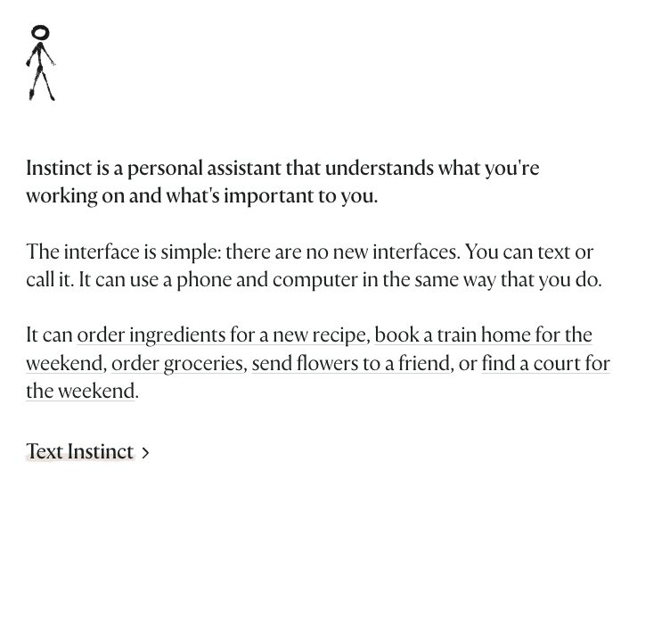

## Talking to the organisation about agentic flooding

Until recently you needed to be a committed hobbyist and tinkerer to get an AI agent working well enough to carry out tasks for you. The commercial products are now good enough to play a pretty significant role in your day-to-day admin (if you’re happy with some pretty wild terms of service).
I’ve been testing the [Instinct Beta](https://instinct.com/), slowly letting it creep into more corners of my life admin. I’ve given it a virtual debit card, an email account, some account passwords (held in a password vault) and some rules about what it can and cannot do on my behalf. With a voice-note instruction in whatsapp the agent has successfully snagged limited stock 30th Anniversary Pokemon cards for my kids, ordered the big shop, booked a bulky waste collection, got £50 compensation from a pension provider and built maps with me for the [30DayMapChallenge](https://30daymapchallenge.com/).
At Kingston and Sutton councils we can see the early indicators of AI driving demand. The canary in the coal mine is complaints and requests for information (FOI, SAR, PSR) - where we are seeing increases in volume and complexity. Academic research (Chris Schmitz, Lewis Hammond, Alan Chan [https://arxiv.org/abs/2608.16603](https://arxiv.org/abs/2608.16603)) shows this is a pattern for public services across a number of jurisdictions. It’s likely a lot of this is driven by copy and pasting from ChatGPT, Claude and Gemini. As agents become more popular we can expect this to increase again and across many more services.
[Tom Loosemore has been blogging](https://loosemore.com/) about his experiments with agents and doing some of the hard thinking about what this might all mean, pulling in other designers and technologists to talk in the open about how services might respond. Working in the open and thinking out loud like this helped shape a few workshops with colleagues. We got groups of senior leaders, heads of service and frontline staff together and shared some stories about how agents are helping people get things done then asked them to work through what that might mean for their own service. We asked two questions: (1) what would happen if all of your potential users had an agent working on their behalf 24/7? (2) What would you do to manage the impact?
The answers to the second question show how challenging this will be and why some of the ‘obvious’ answers are likely to be wrong. They fell into a few categories:
- Demand suppression and bot blocking - adding CAPTCHAs, making more forms, detecting AI, rejecting agent written text (agents are sneaky and this probably wont work)
- Regulatory scope narrowing - [stopping the clock on complex AI drafted requests](https://ico.org.uk/for-organisations/uk-gdpr-guidance-and-resources/subject-access-requests/subject-access-requests-generated-by-artificial-intelligence/), refusing on grounds of cost or vexatious / unreasonable
- Fighting fire with fire - symmetrical AI triage, response drafting and redaction. Building and deploying agents for ai-assisted case handling
- Collaborating - working with LOTI and GDS local to design sector based responses and build reusable tools
- Retire open free text channels - shifting to schema driven intake, designing processes that work for people and for their agents
- APIs that are so good agents prefer to use them - expose preferred routes to the internet, share documentation that steers agents towards good behaviour
- Proactive publication of open and clearly licensed data
I don’t expect regulation to move fast enough to set the rules before we start to be overwhelmed, so it was important to start the conversation with colleagues. This is a proper multi-disciplinary problem and we will need frontline services, technologists, policy people and lawyers in the room for the work that comes next.

